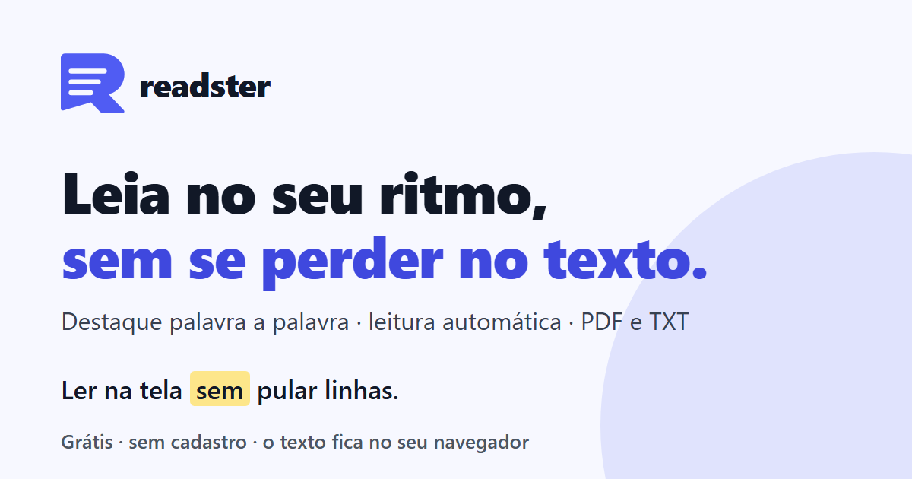

<p align="center">
  
</p>

# Readster

**Read at your own pace without losing your place.** Paste a text or open a PDF: Readster highlights the words, moves forward on its own at the speed you choose and remembers where you stopped.

**[readster.luizgcl.com.br](https://readster.luizgcl.com.br)** · [Português](README.md)

Free, no sign-up, and your text stays in your browser. The app interface is in Brazilian Portuguese.

## Features

- **Word highlighting** over the full text, one or more words at a time, in the color you prefer (yellow, green, blue, pink or underline).
- **Word by word (RSVP)**: words always appear in the same spot, with the focus letter marked.
- **Auto play** from 100 to 700 words per minute, pausing after commas and periods.
- **Library** with the progress of each text: pick up where you left off.
- **.txt and .pdf files** (PDFs with selectable text; the PDF is read on your device).
- **Reading settings**: font, size, line height, text width and focus mode.
- **Keyboard shortcuts** (`?` lists them all), light and dark themes, and a phone-friendly layout.

Readster doesn't promise you'll read faster. It helps you keep focus and a steady pace.

## Privacy

There is no text server and no account. Text, progress and preferences live in the browser's `localStorage`. Clearing browser data deletes the library, and each device has its own.

## Tech stack

- [Angular 21](https://angular.dev) with standalone components, SSR and a prerendered landing page
- [Tailwind CSS 3](https://tailwindcss.com) and [Lucide](https://lucide.dev) icons
- [pdf.js](https://mozilla.github.io/pdf.js/) (loaded only when a PDF is opened)
- Tests with Karma and Jasmine
- Hosted on [Vercel](https://vercel.com)

## Running locally

Requires Node.js 22.13 or newer.

```bash
npm install
npm start          # http://localhost:4200
npm test           # unit tests
npm run build      # production build in dist/readster
```

### Structure

```
src/app/
  pages/          landing page, library, new reading and reading
  components/     reader, settings controls (stepper, segmented), dialogs
  layout/         frame of the app screens (/app)
  preferences.ts  preferences, library and stats in localStorage
  reading.ts      tokenizing, time per word, focus letter
  pdf.ts          PDF text extraction
  seo.ts          canonical, robots and structured data
```

## Contributing

Contributions are welcome: code, copy fixes, ideas and bug reports. Portuguese or English are both fine.

1. Open an [issue](https://github.com/luizgcl/readster/issues) describing the problem or idea. For large changes, agree on the approach first.
2. Fork, create a branch (`feat/my-idea` or `fix/my-fix`) and keep the change focused.
3. Run `npm test` and `npm run build` before opening the pull request.
4. In the pull request, explain what changed, why and how you tested it. Visual changes are easier to review with phone and desktop screenshots.

Principles the project follows:

- Works without an account or backend: the text never leaves the browser.
- Accessibility first: contrast, visible focus, labels and touch targets of at least 44 px.
- No new dependencies when a few lines will do.
- No claims about reading speed or comprehension gains without evidence.

## License

[MIT](LICENSE)
