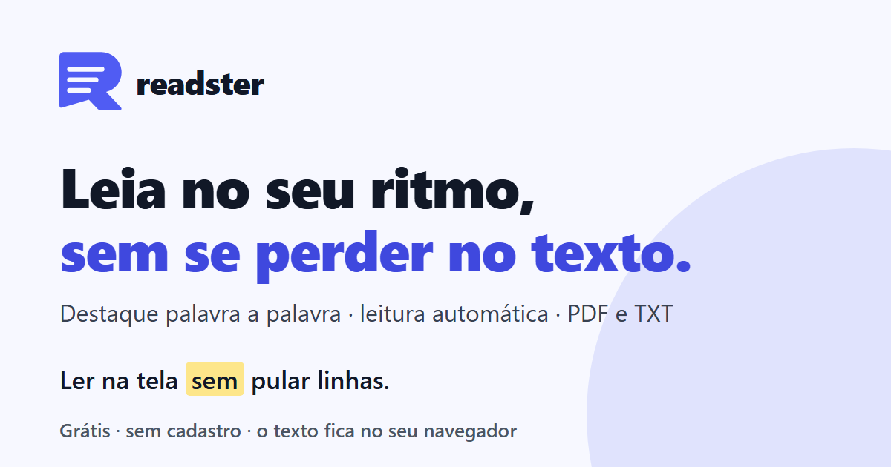

<p align="center">
  
</p>

# Readster

**Leia no seu ritmo, sem se perder no texto.** Cole um texto ou abra um PDF: o Readster destaca as palavras, avança sozinho na velocidade que você escolher e lembra onde você parou.

**[readster.luizgcl.com.br](https://readster.luizgcl.com.br)** · [English](README.en.md)

Grátis, sem cadastro, e o texto fica no seu navegador.

## Recursos

- **Destaque de palavras** no texto completo, uma ou mais por vez, com cor à sua escolha (amarelo, verde, azul, rosa ou sublinhado).
- **Palavra a palavra**: as palavras aparecem sempre no mesmo lugar, com a letra de foco marcada.
- **Leitura automática** de 100 a 700 palavras por minuto, com pausas depois de vírgulas e pontos.
- **Biblioteca** com o progresso de cada texto: continue de onde parou.
- **Arquivos .txt e .pdf** (PDFs com texto selecionável; o PDF é lido no próprio aparelho).
- **Ajustes de leitura**: fonte, tamanho, entrelinha, largura do texto e modo foco.
- **Atalhos de teclado** (`?` mostra todos), tema claro e escuro, e layout para celular.

O Readster não promete que você vai ler mais rápido. Ele ajuda a manter o foco e um ritmo constante.

## Privacidade

Não há servidor de textos nem conta. Texto, progresso e preferências ficam no `localStorage` do navegador. Limpar os dados do navegador apaga a biblioteca, e cada aparelho tem a sua.

## Tecnologias

- [Angular 21](https://angular.dev) com componentes standalone, SSR e pré-renderização da landing page
- [Tailwind CSS 3](https://tailwindcss.com) e ícones [Lucide](https://lucide.dev)
- [pdf.js](https://mozilla.github.io/pdf.js/) (carregado só ao abrir um PDF)
- Testes com Karma e Jasmine
- Hospedagem na [Vercel](https://vercel.com)

## Rodando localmente

Requer Node.js 22.13 ou mais recente.

```bash
npm install
npm start          # http://localhost:4200
npm test           # testes unitários
npm run build      # build de produção em dist/readster
```

### Estrutura

```
src/app/
  pages/          landing page, biblioteca, nova leitura e leitura
  components/     leitor, ajustes (stepper, opções lado a lado), diálogos
  layout/         moldura das telas do app (/app)
  preferences.ts  preferências, biblioteca e estatísticas no localStorage
  reading.ts      tokenização, tempo por palavra, ponto de foco
  pdf.ts          extração de texto de PDF
  seo.ts          canonical, robots e dados estruturados
```

## Como contribuir

Contribuições são bem-vindas: código, correções de texto, ideias e relatos de problemas.

1. Abra uma [issue](https://github.com/luizgcl/readster/issues) descrevendo o problema ou a ideia. Para mudanças grandes, combine antes de começar.
2. Faça um fork, crie uma branch (`feat/minha-ideia` ou `fix/meu-ajuste`) e mantenha a mudança focada.
3. Rode `npm test` e `npm run build` antes de abrir o pull request.
4. No pull request, conte o que mudou, por quê e como você testou. Mudanças visuais ficam melhores com prints no celular e no computador.

Alguns cuidados que o projeto segue:

- Funciona sem conta e sem backend: o texto nunca sai do navegador.
- Acessibilidade em primeiro lugar: contraste, foco visível, rótulos e áreas de toque de pelo menos 44 px.
- Sem dependências novas quando poucas linhas resolvem.
- Nada de prometer ganhos de velocidade ou compreensão sem evidência.

## Licença

[MIT](LICENSE)
